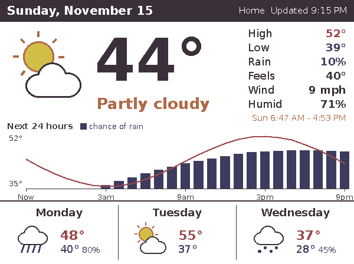

# InkFrame

A weather dashboard, photo slideshow, Wikimedia picture of the day and calendar for the Pimoroni Inky Impression 5.7" (7-colour, 600×448), running on a Raspberry Pi Zero W.



## Buttons

| Button | Action |
| --- | --- |
| A | Weather dashboard |
| B | Photo slideshow |
| C | Wikimedia Commons Picture of the Day |
| D | Calendar |
| Hold D (2 s) | Clean the screen to reduce ghosting, then redraw |

Pressing the button for the mode that's already showing refreshes it: the next photo in the slideshow, or fresh weather or calendar data. Buttons act when released, so a hold can be told apart from a press.

A refresh takes about 30 seconds. Presses made during a refresh are not lost: the most recent one runs when the refresh finishes.

## Install

Enable SPI and I2C, and on current Raspberry Pi OS add `dtoverlay=spi0-0cs` to `/boot/firmware/config.txt`, then reboot. Then:

```bash
git clone <this repo> ~/inkframe
cd ~/inkframe
./install.sh
nano config.toml          # set latitude / longitude
sudo systemctl start inkframe
```

`install.sh` reuses the virtual environment at `~/inky-env` (override with `VENV=...`), copies `config.example.toml` to `config.toml`, creates `~/Pictures/inkframe`, and installs a systemd service that starts on boot.

## Photos

Put photos in `~/Pictures/inkframe` (subfolders work). From another computer:

```bash
scp *.jpg nathan@<pi-address>:~/Pictures/inkframe/
```

Photos are shown in a random order with no repeats until every photo has been shown. New photos are picked up automatically. Bright, high-contrast images with large areas of colour look best on this panel; fine detail and skin tones dither heavily.

## Picture of the day

Button C shows [Wikimedia Commons' Picture of the Day](https://commons.wikimedia.org/wiki/Commons:Picture_of_the_day) with its caption and credit along the bottom. It's downloaded once a day and cached in `~/.local/state/inkframe/potd/`. The mode checks hourly but only redraws the screen when a new day's picture arrives, so it isn't flashing for nothing. Panoramas and very tall pictures are shown whole with white bars rather than cropped; set `fit = "crop"` under `[potd]` to always fill the screen, or `caption = false` to hide the caption.

## Calendar

Button D shows this month with today circled, today's forecast (from the weather mode's last update), and the next 7 days of events. Recurring events, time zones, all-day and multi-day events are all handled; cancelled events and ones that have already ended are hidden.

To connect Google Calendar, open [calendar.google.com](https://calendar.google.com) on a computer, go to **Settings**, pick the calendar under **Settings for my calendars**, then **Integrate calendar**, and copy **Secret address in iCal format**. Add it to `config.toml`:

```toml
[calendar]
sources = [
  "https://calendar.google.com/calendar/ical/.../basic.ics",
  { url = "https://calendar.google.com/calendar/ical/.../basic.ics", colour = "green" },
]
```

Each calendar gets its own colour marker (blue, red, green, orange, black, or set `colour`). The secret address works like a password, which is why it lives in `config.toml` (not committed to git). Event times use the Pi's time zone; check it with `timedatectl` and set it with `sudo timedatectl set-timezone America/New_York` (or yours). Google can take several hours to publish changes to this link.

The calendar checks every 15 minutes but only redraws when something changed, such as a new event or one finishing.

## Running by hand

Stop the service first so two programs don't fight over the display:

```bash
sudo systemctl stop inkframe
~/inky-env/bin/python -m inkframe --once --mode weather     # draw one frame and exit
~/inky-env/bin/python -m inkframe --once --clean            # clean, then draw
~/inky-env/bin/python -m inkframe --dry-run --once          # no display: writes a PNG to ./preview
```

`--dry-run` also works on a normal computer with Pillow installed, for working on layouts.

## Logs

```bash
journalctl -u inkframe -f
```

A copy is kept in `~/.local/state/inkframe/inkframe.log`, along with the last weather data (used when the network is down) and slideshow position.

## Layout

```
inkframe/
  app.py            main loop, buttons -> actions, timers
  display.py        Inky wrapper, palette, dry-run previews
  buttons.py        side buttons via libgpiod
  modes/weather.py  Open-Meteo dashboard (no API key needed)
  modes/slideshow.py
  modes/potd.py     Wikimedia Commons picture of the day
  modes/calendar_mode.py  month grid + agenda from iCal links
  photo.py          shared crop / colour-boost / dither helpers
```

A new mode is a class with `name`, `interval` (seconds), `next()` and `render(size)` returning a Pillow image, registered in `modes/__init__.py` and given a button in `BUTTON_MODES` in `app.py`. An optional `changed()` returning `False` lets timed refreshes skip redrawing. Draw dashboards on `display.new_canvas()` using the palette constants (`BLACK`, `RED`, ...) for crisp, undithered colours; return an RGB image for photos.
